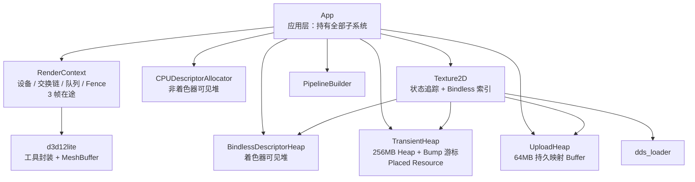
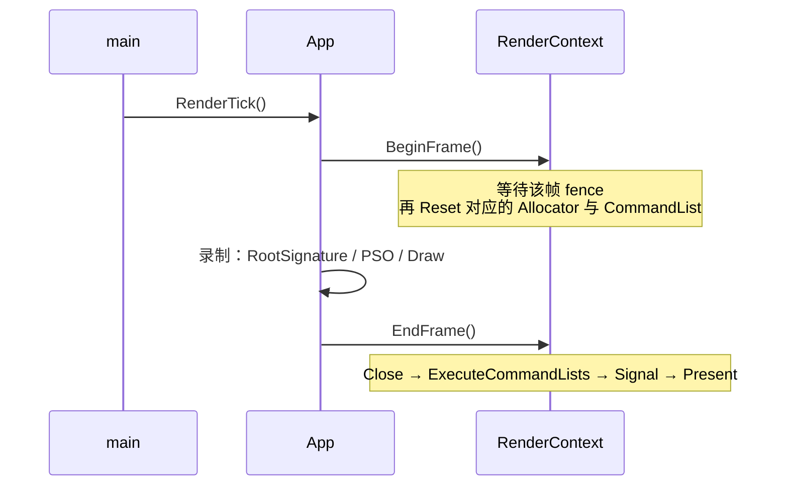

# RenderingProgrameByHand

> 从零手写一个 Direct3D 12 渲染器。不使用任何渲染引擎或第三方框架 —— 只有 Windows SDK 与 DXC。


这是一个 **边写边记** 的 D3D12 学习工程：先搭出一套可控的设备 / 同步 / 内存骨架，再逐层加上描述符分发、显存复用与资源管理。
每一层都尽量自己写而不是调库，目的只有一个 —— 把 **「一次 API 调用，在硬件上到底改了什么」** 弄明白。

---

## 📖 目录

- [已实现的能力](#-已实现的能力)
- [架构](#-架构)
- [构建与运行](#-构建与运行)
- [路线图](#-路线图)
- [工程笔记](#-工程笔记)

---

## ✅ 已实现的能力

| 能力 | 载体 | 说明 |
|:--|:--|:--|
| 多帧在途流水线 | `RenderContext` + `FrameResource` | 默认 **3 帧在途**，每帧一套 `CommandAllocator` / `CommandList` / fence 值 |
| 全局设备与同步上下文 | `RenderContext` | 设备、交换链、命令队列、Fence 与帧索引的集中管理 |
| 命令与工具封装 | `d3d12lite` | 轻量封装层，含 `MeshBuffer` |
| CPU 侧描述符池 | `CPUDescriptorAllocator` | 非着色器可见的 **RTV / DSV 双堆**（默认各 500 槽），空闲链表分配；`Init()` 里为交换链 backbuffer 预留静态槽位 |
| Bindless 描述符分发 | `BindlessDescriptorHeap` | 着色器可见堆，默认容量 **10000**；`GPUDescriptorHandle{cpu, gpu, index}` |
| 瞬态显存复用 | `TransientHeap` | 一块 `ID3D12Heap`（默认 **256 MB**）+ bump 游标，`Reset()` 一键别名覆写 |
| 常驻上传堆 | `UploadHeap` | 初始化时持久 `Map` 的大 buffer（默认 **64 MB**），按 512 / 256 字节对齐切片 |
| 纹理与状态追踪 | `Texture2D` | `CreatePlaced` / `LoadFromFilePlaced`，内部记录 `m_currentState` 与 bindless 索引 |
| 链式 PSO 构建 | `PipelineBuilder` | `SetRootSignature` / `SetInputLayout` / `SetShaders` / `SetRTVFormat` → `Build` |
| DDS 纹理加载 | `dds_loader` | 自带 DDS 解析 |
| 应用层 | `App` | 持有上下文、两个描述符分配器、两个堆、PSO、网格与纹理，驱动单帧流程 |

---

## 🏗 架构



### 单帧流程



### 四类分配器各管一段

| 分配器 | 管的资源 | 分配策略 | 回收方式 |
|:--|:--|:--|:--|
| `CPUDescriptorAllocator` | 非着色器可见描述符 | 空闲链表 | 显式释放 |
| `GPUDescriptorAllocator` | 着色器可见描述符（bindless） | 空闲链表 | 显式释放 |
| `TransientHeap` | 默认堆上的 placed resource | Bump 游标 + `ID3D12Heap` | 帧末 `Reset()` 覆写物理地址 |
| `UploadHeap` | 上传内存（UPLOAD 堆） | Bump 游标 + 512 字节对齐 | GPU 完成后 `Reset()` |

---

## 🚀 构建与运行

**环境要求**

- Windows 10 或更高（x64）
- Visual Studio 2022（`PlatformToolset = v143`）
- Windows SDK 10.0
- 支持 Direct3D 12 的 GPU

**步骤**

```powershell
git clone <repo-url>
cd RenderingProgrameByHand
# 用 VS2022 打开 RenderingProgrameByHand.sln，等待 NuGet 自动还原
# （唯一依赖：Microsoft.Direct3D.DXC 1.9.2609.5）
# 选择 x64 配置生成并运行
```

> ⚠️ DXC 的运行时 `dxcompiler.dll` / `dxil.dll` 必须与可执行文件同目录。仓库已随附这两个 DLL；
> 若构建输出目录里没有，请手工复制一份。

---

## 📌 路线图

- [x] 第一阶段：CPU / GPU 流水线骨架，多帧在途
- [x] 第二阶段：Bindless 描述符分发
- [x] Placed Resource 显存复用 + 瞬态堆
- [x] 持久映射上传堆 + Bump 分配
- [ ] **把 `Pass` 抽象补上** —— `pass.h` 目前还是空壳，`PSO` 仍由 `App` 直接持有
- [ ] 资源状态由渲染图统一推导（目前 `Texture2D` 自己记录 `m_currentState`）
- [ ] 用依赖注入替换全局单例，解除 `RenderContext` 与子系统的耦合
- [ ] 补齐 `UploadHeap` / `TransientHeap` 的**跨帧延迟回收**（当前 `Reset()` 依赖帧同步时机）

---

## 📝 工程笔记

> 以下是开发过程中的原始记录，按主题重新分节。都是踩过坑之后的结论，不是抄来的定义。

### 1. 多帧在途流水线怎么分工

- 实现多帧在途：**核心部分交给 `RenderContext`，PSO 部分交给 `Pass`**。
- `ID3D12GraphicsCommandList` 与 `ID3D12CommandList`：前者由后者派生，实际使用几乎总是前者。
- **只在 `.cpp` 中包含** 相关头文件，避免头文件循环依赖；需要调静态方法时，在 `.cpp` 里 `#include "RenderContext.h"`。

### 2. RenderContext：显式生命周期的单例

一开始希望把 `RenderContext` 做成全局唯一的状态与基础设备管理器 —— 否则 `d3d12lite` 里的工具方法要频繁传入 `device` / `queue`，非常啰嗦。

做法：**类的静态变量只存一个 8 字节指针**（64 位平台下仅 8 字节，位于 `.bss` 静态数据区），在 `Init()` 里通过

```cpp
s_instance = this;   // 把实例地址交给全局
```

绑定实例。运行时先实例化并 `Init()`，之后才能调 `Get()`（**顺序错了就是空指针**）。

后续优化方向：把依赖**注入**到子系统，替换掉这个全局单例。

> 参考：`RenderContext` 的 `Init` 方法与 `FenceEvent` 的创建位置。

### 3. `const` 放在哪一边

- 所有 `Get` 类函数都要加 `const`，避免外部修改。
- 区分**顶层 const** 与**底层 const**：

```cpp
ComPtr<ID3D12Device>* const p;    // p 本身不能改指向，但能改它指向的对象
const ComPtr<ID3D12Device>* p;    // 修饰的是被指向的对象
```

- 在 DX 开发中**两者都不建议用**：`ID3D12Device` 上有相当多常用函数是非 `const` 的，加了限制反而处处别扭。

### 4. 屏障封装与结构体初始化

- 对 `ResourceBarrier` 做一层封装，避免到处手写。
- **★★ 给结构体加上 `= {}` 是一个救命的习惯。** 以 `D3D12_RESOURCE_BARRIER` 为例：C++ 默认不做任何初始化，此时 `Type` / `Flags` 以及内部那个联合体（`Transition` / `Aliasing` / `UAV`）全是内存里的垃圾值；**只对其中一部分赋值就会直接报错**。
- 另一个相关陷阱：**就算构造函数参数有默认值，也不要用空 `{}` 当作初始化** —— 那会被编译器看成一次**声明**（most vexing parse）。
- `D3D12_CPU_DESCRIPTOR_HANDLE` 本质和虚拟地址差不多，是个**句柄**（内部只有一个 `ptr`）。
- **绝对不要把带副作用的代码放进 `assert` 里** —— Release 构建下 `assert` 被裁掉，副作用会凭空消失。

### 5. `inline` 到底解决什么问题

先看现代编译链接流程：**预处理 → 编译 → 汇编 → 链接**。

<details>
<summary><b>展开：四个阶段的细节</b></summary>

**① 预处理**：只是一个文本替换引擎，不理解 C++ 语法。负责头文件展开、宏展开与条件编译、剔除注释与标记行号、防止重复包含，产出 `.i` 文件。

**② 编译与汇编**：编译器接收预处理后的纯文本，转换为平台相关的机器指令，输出目标文件（Windows 下 `.obj`，Linux 下 `.o`）。此阶段**各 `.cpp` 完全并行**。期间做语法分析、语义分析、中间代码生成与优化（IR）、代码生成与汇编。

`.obj` 内部结构：

- **节区**：`.text` / `.data` / `.bss` / `.rodata`
- **符号表**
- **重定位表**：调用另一个 `.cpp` 里的函数或数据时，本阶段生成的机器码里并没有那些符号的具体地址，重定位表记录了机器码中所有**临时地址占位符的位置**，留给链接阶段填空。

**③ 链接**：链接器接收所有 `.obj` 与外部静态库（`.lib`），把分散的机器码和数据拼装成完整的可执行镜像。

- 节区合并
- **符号解析**：做 ODR 校验 —— 若一个普通强符号在多个 `.obj` 中都有实体定义，直接报错终止
- 重定位修补

</details>

由此得到 `inline` 的四个作用：

1. **解决链接期的单一定义（ODR）冲突** —— 这是它最重要的作用。多个 `.cpp` 中只要保证只有一个定义是非 `inline` 的，就能避免重复定义错误。
2. **C++17 后可以在头文件里直接定义静态变量**。C++17 之前，全局 static 变量只能在 `.h` 里声明、在 `.cpp` 里定义；C++17 后可以写 `inline static T a = nullptr;` 直接在头文件定义 —— 本工程的 `RenderContext::s_instance` 就是这么写的。
3. **作为编译器的优化提示**（这个作用已被弱化，现代编译器自己会判断）。
4. **模板全特化**场景下的链接处理。

### 6. 描述符与 MRT

在 `CommandList` 上绑定 RTV 是通过 **handle** 完成的；正因为是 handle，所以可以传**数组**做 Multiple Render Targets 绑定，配对着色器里的多个输出语义：

```hlsl
struct GBufferOutput
{
    float4 albedo   : SV_Target0;
    float4 normal   : SV_Target1;
    float4 material : SV_Target2;
};
```

### 7. `IID_PPV_ARGS`

这是 Windows / COM 开发（尤其 D3D11 / D3D12）中最常用的宏之一。它做两件事：

1. 自动提取接口的 **IID**（接口标识符，在 COM 与 DirectX 里就是一个 GUID，相当于给接口发的唯一身份证号）；
2. 把智能指针的地址转换为 API 要求的 `void**` 双重指针。

底层依赖 `IUnknown::QueryInterface`。

### 8. `HEAP_STATE` vs `RESOURCE_STATE`

原生 API 中**并没有** `D3D12_HEAP_STATE` 这个枚举，也没有对应的管线状态机。常说的 "heap state" 指的是**显存块的物理常驻性与分配属性**：

| | 管什么 | 回答的问题 |
|:--|:--|:--|
| **Heap** | 内存在哪、能否被 GPU 物理访问 | 这块内存是 DEFAULT / UPLOAD / READBACK？在本地显存还是共享内存？ |
| **Resource State** | 绑定在该显存之上的资源，在 GPU 管线中的**动态访问契约**与压缩布局 | 数据如何被缓存、被哪个管线阶段、以何种格式读写？ |

一句话：**heap 管内存放在哪，resource 管这块内存怎么被解释。**

### 9. 上传路径：`footprint` 与 `copy location`

两条不同的路径，用的是两套描述结构：

- **Host → Buffer（UPLOAD 堆）**：需要 **footprint**
- **Upload Buffer → Default Texture**：需要 **copy location**

| 结构 | 内容 |
|:--|:--|
| `D3D12_PLACED_SUBRESOURCE_FOOTPRINT` | 主要为了**对齐**：`RowPitch` / `Width` / `Height` |
| `D3D12_TEXTURE_COPY_LOCATION` | 资源指针 + 寻址模式枚举 + 一个联合体：<br/>· Buffer 侧 → footprint（Buffer 的几何描述）<br/>· Texture 侧 → `uint` 子资源索引 |

### 10. 两种「虚拟地址」不是一回事

- `DescriptorHeap` 的 CPU / GPU 地址是 **handle**（里面只有一个 `ptr`）。
- `Heap` 的 GPU 虚拟地址要用 `GetGPUVirtualAddress()` 拿，返回类型 `D3D12_GPU_VIRTUAL_ADDRESS` 是 `uint64` 的别名。

**两者语义不同，不要互相混用。**

---

## 📄 许可

本仓库尚未声明开源许可证。若需转载或引用其中的代码，请先联系作者。
