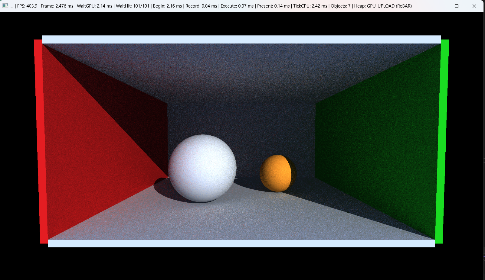
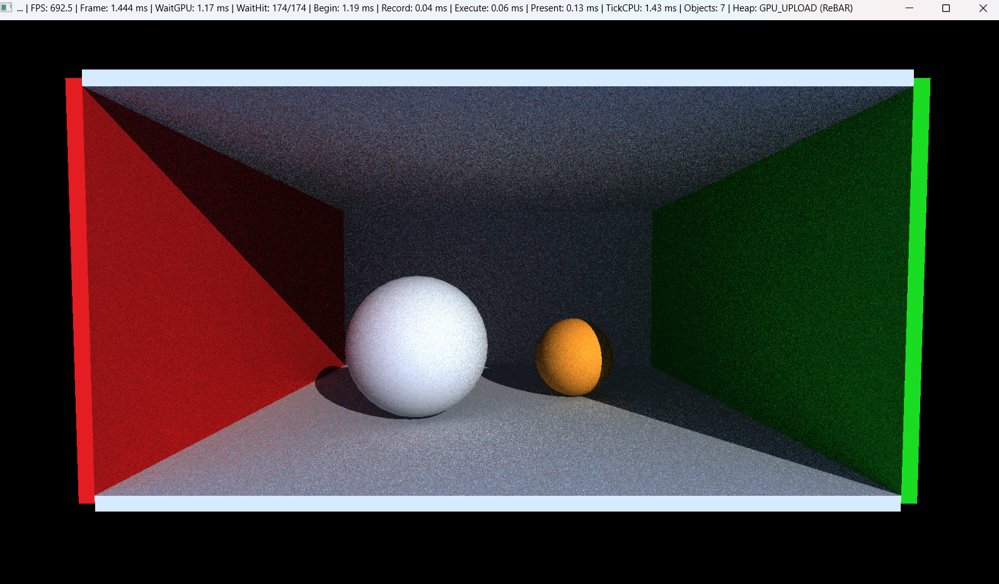
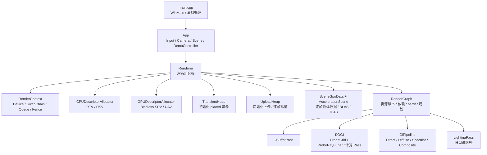
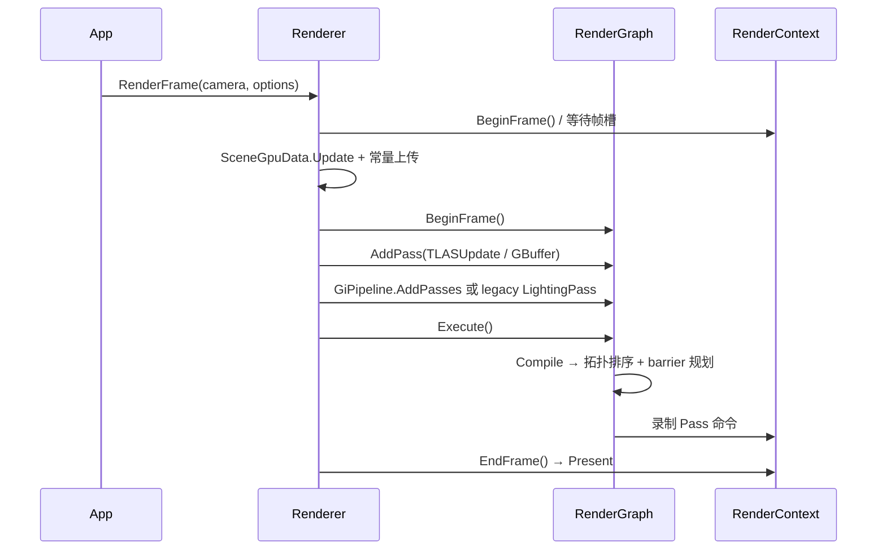

# RenderingProgrameByHand

> 从零手写一个 Direct3D 12 渲染器。不使用任何渲染引擎或第三方框架 —— 只有 Windows SDK 与 DXC。


这是一个 **边写边记** 的 D3D12 学习工程：先搭出一套可控的设备 / 同步 / 内存骨架，再逐层加上描述符分发、显存复用与资源管理。
每一层都尽量自己写而不是调库，目的只有一个 —— 把 **「一次 API 调用，在硬件上到底改了什么」** 弄明白。

---

## 📖 目录

- [已实现的能力](#-已实现的能力)
- [效果展示](#-效果展示)
- [交互与调试](#-交互与调试)
- [更新记录](#-更新记录)
- [架构](#-架构)
- [构建与运行](#-构建与运行)
- [路线图](#-路线图)
- [工程笔记](#-工程笔记)

---

## ✅ 已实现的能力

| 能力 | 载体 | 说明 |
|:--|:--|:--|
| 应用 / 渲染分层 | `App` / `Renderer` | `App` 只负责 Win32 输入、相机、场景和 `RenderOptions`；GPU 资源与 Pass 全部由 `Renderer` 持有 |
| 多帧在途流水线 | `RenderContext` + `FrameResource` | 默认 **3 帧在途**，每帧一套 `CommandAllocator` / `CommandList` / fence 值 |
| 设备与同步上下文 | `RenderContext` | 设备、交换链、命令队列、Fence、适配器选择与帧索引 |
| RenderGraph | `RenderGraph` | 资源版本、RAW / WAR / 版本顺序边、拓扑排序、Transition / UAV barrier 规划、编译期校验 |
| Bindless 描述符 | `BindlessDescriptorHeap` | 着色器可见 `CBV_SRV_UAV` 堆，默认 **10000** 槽；`GPUDescriptorHandle{cpu, gpu, index}` |
| CPU 描述符池 | `CPUDescriptorAllocator` | 非着色器可见 **RTV / DSV 双堆**（默认各 500 槽），预填槽位栈，分配后由调用方创建 view |
| 初始化 placed 资源 | `TransientHeap` | 一块 `ID3D12Heap`（默认 **256 MB**）+ bump 游标；当前用于初始化纹理和网格，尚未做逐帧 transient aliasing |
| 上传内存 | `UploadHeap` | 持久映射的大 buffer（默认 **64 MB**），支持 UPLOAD / GPU_UPLOAD；初始化上传与逐帧常量 |
| 纹理与状态追踪 | `Texture2D` | `CreatePlaced` / `LoadFromFilePlaced`，内部记录状态与 bindless 索引 |
| 链式 PSO 构建 | `PipelineBuilder` | 根签名、shader blob、RTV 格式、深度/光栅状态 → PSO |
| 延迟渲染 | G-buffer + `GiPipeline` | albedo / world normal / volume mask + depth；由深度重建世界坐标 |
| 光线追踪 | `rt::AccelerationScene` | BLAS/TLAS 构建与 SRV 绑定；太阳阴影、光追 GI 与 DDGI 探针求交 |
| DDGI | `DDGI` + `ProbeGrid` | 10×5×10 探针网格、每探针 256 条 ray、原始/滤波辐照度图集、距离矩、体积掩码 |
| GI 编排 | `GiPipeline` | Direct → Diffuse Provider → Specular Provider → Composite；支持 DDGI / SSGI / RayTraced / SSR / None |
| 显示与调试 | `GiDisplayMode` + legacy Lighting | Composite / DiffuseOnly / SpecularOnly；旧 `LightingPass` 保留为调试路径 |
| 逐实例 GPU 数据 | `GPU_UPLOAD` + bindless SRV | `GPUObjectData` 存每个实例的 world / normal / albedo / VB / IB 槽 |
| 统计 | `App` 标题栏 | FPS、Frame、WaitGPU、Record / Execute / Present、TickCPU、Upload 堆类型 |

---

## 📸 效果展示

### 纯光追 GI（one-bounce path tracing，2026-10-24）

Cornell Box 场景：主射线命中的可见点按余弦加权半球采样 2 条 GI 射线；命中点通过 `GPUObjectData` 取回世界位置 / 法线 / albedo，再打一条太阳阴影射线，累加成间接光（color bleeding）。当前为未累积的 2 SPP，噪点明显。

| 视角 1（约 403 FPS） | 视角 2（约 692 FPS） |
|:--:|:--:|
|  |  |

> 下一步：时间累积 + QMC（低差异序列）采样降噪，然后进入 DDGI 探针系统。

---

## 🎮 交互与调试

| 按键 | 行为 |
|:--|:--|
| `1` / `F1` | DDGI 漫反射 + Composite |
| `2` / `F3` | 纯光追漫反射 + Composite |
| `3` | DDGI + DiffuseOnly |
| `4` | 纯光追 + DiffuseOnly |
| `F2` | SSGI + Composite |
| `F4` | 关闭漫反射 GI |
| `F5` / `F6` | 镜面 GI Off / SSR |
| `F7` / `F8` | SpecularOnly / Composite 显示 |
| `R` | 重置 DDGI 历史 |
| `N` | 法线调试 |
| `5`–`0`、`P`、`T`、`V` | 旧 Lighting 调试视图（探针有效数、Chebyshev、图集、距离矩、探针位置等） |

> `GiDisplayMode` 只决定 Composite 读取哪些 GI 通道，不改变实际执行的漫反射/镜面算法；算法由 `DiffuseGiMode` / `SpecularGiMode` 选择。

---

## 🗓 更新记录

| 日期 | 更新内容 |
|:--|:--|
| 2026-11-22 | **Renderer / GiPipeline / RenderGraph 改造**：App 不再持有 GPU 资源；新增 GI Provider 编排层；RenderGraph 支持资源版本、RAW/WAR 依赖、拓扑排序、自动 Transition/UAV barrier 与 TLAS 图资源跟踪 |
| 2026-10-24 | **纯光追 GI（one-bounce path tracing）**：命中点取几何属性 + 二次阴影射线，Cornell Box 出现 color bleeding；README 增加效果展示与更新记录模块 |
| 2026-10-23 | **DXR 光追**：BLAS/TLAS 构建 + `rt::AccelerationScene` 封装 + 像素着色器 ray query 太阳阴影；`GPUObjectData` 走 GPU_UPLOAD + bindless SRV，供 GI 使用；README 补充工程笔记 |
| 2026-10-22 | **延迟渲染**：G-buffer（albedo / world normal）+ 全屏 Lighting pass、`RenderTexture` 多渲染目标、debug 视图；GPU 计时体系（Record / Execute / Present / WaitGPU / WaitHit） |
| 2026-10-22 | **多物体场景**：PerObject root constants + `MeshLibrary` + `RenderObject` 循环，bindless 顶点拉取；场景切换为 Cornell Box |
| 2026-10-15 | **仓库初始化**：`RenderContext` 多帧在途、CPU/GPU 描述符分配器、`TransientHeap`、`UploadHeap`、`PipelineBuilder`、DDS 加载等基础骨架 |

---

## 🏗 架构

### 分层与持有关系



### 单帧流程



### 资源与描述符

| 对象 | 管的资源 | 分配策略 | 当前回收策略 |
|:--|:--|:--|:--|
| `CPUDescriptorAllocator` | RTV / DSV | 预填槽位栈 | 只分配，不回收 |
| `GPUDescriptorAllocator` | bindless SRV / UAV | 预填槽位栈 | 只分配，不回收；容量固定 |
| `TransientHeap` | placed texture / mesh | `ID3D12Heap` + bump 游标 | 初始化阶段使用，尚未做逐帧 aliasing |
| `UploadHeap` | 初始化上传 / 逐帧常量 | 持久映射 + bump 游标 | 初始化结束后 `Reset()`，逐帧槽位由 fence 复用 |

`RenderGraph` 只保存裸资源指针和状态，不拥有资源；资源由 `Renderer`、`DDGI`、`GiPipeline` 等所有者创建和释放。

---

## 🚀 构建与运行

**环境要求**

- Windows 10 或更高（x64）
- Visual Studio 2022（`PlatformToolset = v143`）
- Windows SDK 10.0
- 支持 Direct3D 12 的 GPU

**步骤**

```powershell
git clone <repo-url>
cd RenderingProgrameByHand
# 用 VS2022 打开 RenderingProgrameByHand.sln，等待 NuGet 自动还原
# （唯一依赖：Microsoft.Direct3D.DXC 1.9.2609.5）
# 选择 x64 配置生成并运行
```

> ⚠️ DXC 的运行时 `dxcompiler.dll` / `dxil.dll` 必须与可执行文件同目录。仓库已随附这两个 DLL；
> 若构建输出目录里没有，请手工复制一份。

---

## 📌 路线图

- [x] 第一阶段：CPU / GPU 流水线骨架，多帧在途
- [x] 第二阶段：Bindless 描述符分发
- [x] Placed Resource 初始化路径 + 上传堆
- [x] `Pass` 抽象 + `Renderer` 统一持有 PSO / GPU 资源
- [x] RenderGraph 资源版本、RAW/WAR 依赖、拓扑排序、Transition/UAV barrier 规划
- [x] TLAS 作为 RenderGraph 资源跟踪
- [x] App / Renderer / DDGI / GiPipeline 模块化
- [x] DDGI / SSGI / RayTraced / SSR 的 GI Provider 编排
- [ ] 窗口 resize / swapchain / G-buffer / GI target 重建
- [ ] 真正的逐帧 transient 资源池与显存 aliasing
- [ ] 描述符回收与跨帧延迟释放
- [ ] 把 `ProbeRelocationPass` 接回 DDGI 更新序列
- [ ] 统一 legacy Lighting 与 GiPipeline，减少双路径维护成本
- [ ] TAA / tone mapping / 动态分辨率
- [ ] async compute / 多队列同步
- [ ] 依赖注入替换全局 `RenderContext` 单例

### RenderGraph 当前行为

`AddPass` 只收集声明；`Compile` 负责校验、建边、排序和 barrier 规划；`Execute` 才真正插 barrier 并执行。

- `Write(id, state)` 默认产出版本 1；`Read(id, state)` 默认读取本帧最终版本。
- `ReadWrite(id, state, 2)` 表示读版本 1、写版本 2；DDGI 的 ray buffer、图集补边和 fixup 使用这种方式。
- `FrameLocal` 资源的首个读者必须有本帧生产者；`Preserved` 允许读版本 0，例如 DDGI 历史图集。
- `Compile` 建立：

```text
RAW：writer(v) → reader
WAR：reader → writer(v+1)
版本顺序：writer(v) → writer(v+1)
最终转换：所有访问 → Transition
```

- `Compile` 使用确定性拓扑排序；缺少 writer、多个 writer、非法版本、依赖环等直接抛 `std::logic_error`。
- `BuildBarrierPlan` 预生成每个 Pass 的 Transition / UAV barrier；`Execute` 批量提交。
- `GetCompiledPasses()` 可查看执行顺序和 barrier，`GetLifetime(id)` 给出编译后执行序号中的 firstUse / lastUse。

当前图仍工作在同一条 DIRECT 队列上，按整个资源追踪状态；`ResourceLifetime` 还没有用于 transient 分配或 aliasing。

### 已知限制

- 渲染分辨率固定为 1920×1080，窗口 resize 尚未接入。
- 描述符分配器只有 Allocate，没有 Free / 跨帧回收。
- G-buffer、GI HDR 目标、DDGI 图集都是持久资源，没有 transient 池。
- RenderGraph 没有 Pass culling、subresource 状态或 async compute 同步。
- `ProbeRelocationPass` 已初始化，但当前未加入 `DDGI::AddUpdatePasses`。
- legacy `LightingPass` 与 `GiPipeline` 仍并存，前者主要用于调试视图。
- 没有 TAA、denoiser、tone mapping 或动态分辨率。

---

## 📝 工程笔记

> 以下按开发阶段记录，保留当时的思路和踩坑结论；部分内容已经被当前架构替换，当前行为以「已实现的能力 / 架构 / 路线图」为准。

### 1. 多帧在途流水线怎么分工

- 实现多帧在途：**核心部分交给 `RenderContext`，PSO 部分交给 `Pass`**。
- `ID3D12GraphicsCommandList` 与 `ID3D12CommandList`：前者由后者派生，实际使用几乎总是前者。
- **只在 `.cpp` 中包含** 相关头文件，避免头文件循环依赖；需要调静态方法时，在 `.cpp` 里 `#include "RenderContext.h"`。

### 2. RenderContext：显式生命周期的单例

一开始希望把 `RenderContext` 做成全局唯一的状态与基础设备管理器 —— 否则 `d3d12lite` 里的工具方法要频繁传入 `device` / `queue`，非常啰嗦。

做法：**类的静态变量只存一个 8 字节指针**（64 位平台下仅 8 字节，位于 `.bss` 静态数据区），在 `Init()` 里通过

```cpp
s_instance = this;   // 把实例地址交给全局
```

绑定实例。运行时先实例化并 `Init()`，之后才能调 `Get()`（**顺序错了就是空指针**）。

后续优化方向：把依赖**注入**到子系统，替换掉这个全局单例。

> 参考：`RenderContext` 的 `Init` 方法与 `FenceEvent` 的创建位置。

### 3. `const` 放在哪一边

- 所有 `Get` 类函数都要加 `const`，避免外部修改。
- 区分**顶层 const** 与**底层 const**：

```cpp
ComPtr<ID3D12Device>* const p;    // p 本身不能改指向，但能改它指向的对象
const ComPtr<ID3D12Device>* p;    // 修饰的是被指向的对象
```

- 在 DX 开发中**两者都不建议用**：`ID3D12Device` 上有相当多常用函数是非 `const` 的，加了限制反而处处别扭。

### 4. 屏障封装与结构体初始化

- 对 `ResourceBarrier` 做一层封装，避免到处手写。
- **★★ 给结构体加上 `= {}` 是一个救命的习惯。** 以 `D3D12_RESOURCE_BARRIER` 为例：C++ 默认不做任何初始化，此时 `Type` / `Flags` 以及内部那个联合体（`Transition` / `Aliasing` / `UAV`）全是内存里的垃圾值；**只对其中一部分赋值就会直接报错**。
- 另一个相关陷阱：**就算构造函数参数有默认值，也不要用空 `{}` 当作初始化** —— 那会被编译器看成一次**声明**（most vexing parse）。
- `D3D12_CPU_DESCRIPTOR_HANDLE` 本质和虚拟地址差不多，是个**句柄**（内部只有一个 `ptr`）。
- **绝对不要把带副作用的代码放进 `assert` 里** —— Release 构建下 `assert` 被裁掉，副作用会凭空消失。

### 5. `inline` 到底解决什么问题

先看现代编译链接流程：**预处理 → 编译 → 汇编 → 链接**。

<details>
<summary><b>展开：四个阶段的细节</b></summary>

**① 预处理**：只是一个文本替换引擎，不理解 C++ 语法。负责头文件展开、宏展开与条件编译、剔除注释与标记行号、防止重复包含，产出 `.i` 文件。

**② 编译与汇编**：编译器接收预处理后的纯文本，转换为平台相关的机器指令，输出目标文件（Windows 下 `.obj`，Linux 下 `.o`）。此阶段**各 `.cpp` 完全并行**。期间做语法分析、语义分析、中间代码生成与优化（IR）、代码生成与汇编。

`.obj` 内部结构：

- **节区**：`.text` / `.data` / `.bss` / `.rodata`
- **符号表**
- **重定位表**：调用另一个 `.cpp` 里的函数或数据时，本阶段生成的机器码里并没有那些符号的具体地址，重定位表记录了机器码中所有**临时地址占位符的位置**，留给链接阶段填空。

**③ 链接**：链接器接收所有 `.obj` 与外部静态库（`.lib`），把分散的机器码和数据拼装成完整的可执行镜像。

- 节区合并
- **符号解析**：做 ODR 校验 —— 若一个普通强符号在多个 `.obj` 中都有实体定义，直接报错终止
- 重定位修补

</details>

由此得到 `inline` 的四个作用：

1. **解决链接期的单一定义（ODR）冲突** —— 这是它最重要的作用。多个 `.cpp` 中只要保证只有一个定义是非 `inline` 的，就能避免重复定义错误。
2. **C++17 后可以在头文件里直接定义静态变量**。C++17 之前，全局 static 变量只能在 `.h` 里声明、在 `.cpp` 里定义；C++17 后可以写 `inline static T a = nullptr;` 直接在头文件定义 —— 本工程的 `RenderContext::s_instance` 就是这么写的。
3. **作为编译器的优化提示**（这个作用已被弱化，现代编译器自己会判断）。
4. **模板全特化**场景下的链接处理。

### 6. 描述符与 MRT

在 `CommandList` 上绑定 RTV 是通过 **handle** 完成的；正因为是 handle，所以可以传**数组**做 Multiple Render Targets 绑定，配对着色器里的多个输出语义：

```hlsl
struct GBufferOutput
{
    float4 albedo   : SV_Target0;
    float4 normal   : SV_Target1;
    float4 material : SV_Target2;
};
```

### 7. `IID_PPV_ARGS`

这是 Windows / COM 开发（尤其 D3D11 / D3D12）中最常用的宏之一。它做两件事：

1. 自动提取接口的 **IID**（接口标识符，在 COM 与 DirectX 里就是一个 GUID，相当于给接口发的唯一身份证号）；
2. 把智能指针的地址转换为 API 要求的 `void**` 双重指针。

底层依赖 `IUnknown::QueryInterface`。

### 8. `HEAP_STATE` vs `RESOURCE_STATE`

原生 API 中**并没有** `D3D12_HEAP_STATE` 这个枚举，也没有对应的管线状态机。常说的 "heap state" 指的是**显存块的物理常驻性与分配属性**：

| | 管什么 | 回答的问题 |
|:--|:--|:--|
| **Heap** | 内存在哪、能否被 GPU 物理访问 | 这块内存是 DEFAULT / UPLOAD / READBACK？在本地显存还是共享内存？ |
| **Resource State** | 绑定在该显存之上的资源，在 GPU 管线中的**动态访问契约**与压缩布局 | 数据如何被缓存、被哪个管线阶段、以何种格式读写？ |

一句话：**heap 管内存放在哪，resource 管这块内存怎么被解释。**

### 9. 上传路径：`footprint` 与 `copy location`

两条不同的路径，用的是两套描述结构：

- **Host → Buffer（UPLOAD 堆）**：需要 **footprint**
- **Upload Buffer → Default Texture**：需要 **copy location**

| 结构 | 内容 |
|:--|:--|
| `D3D12_PLACED_SUBRESOURCE_FOOTPRINT` | 主要为了**对齐**：`RowPitch` / `Width` / `Height` |
| `D3D12_TEXTURE_COPY_LOCATION` | 资源指针 + 寻址模式枚举 + 一个联合体：<br/>· Buffer 侧 → footprint（Buffer 的几何描述）<br/>· Texture 侧 → `uint` 子资源索引 |

### 10. 两种「虚拟地址」不是一回事

- `DescriptorHeap` 的 CPU / GPU 地址是 **handle**（里面只有一个 `ptr`）。
- `Heap` 的 GPU 虚拟地址要用 `GetGPUVirtualAddress()` 拿，返回类型 `D3D12_GPU_VIRTUAL_ADDRESS` 是 `uint64` 的别名。

**两者语义不同，不要互相混用。**

---

## 📄 许可

本仓库尚未声明开源许可证。若需转载或引用其中的代码，请先联系作者。


//新内容：
能否用D3D12_HEAP_TYPE_GPU_UPLOAD而不用D3D12_HEAP_TYPE_UPLOAD做逐帧瞬态分配 由FrameResource每帧持有UploadHeap
我想到 我们可能还是需要Texture类的逐帧瞬态资源


由FrameResource持有每帧的UploadHeap同时App持有一个用于上传纹理的UploadHeapGPU
只需在初始每帧最初上传时通过一次经过一次PCIe 后面pass读取都是在VRAM上进行减少了访存时间消耗

RootSignature
采取和Pso一样的链式绑定法则

在单一三角形这一简单渲染场景上看不出GPU_UPLOAD与UPLOAD之间的区别 我们通过以下方法来测验：
1.首先增大frameUploadHeap空间 创建一个32MB的UploadHeap来增大防止在随机访问模式下也能在L2 Cache中读取到对应数据。确保每次访问都要去走PCIe或者通过VRAM来访问
2.在UploadHeap中申请16MB内存并以SRV绑入Descriptor Heap 存储任何合法数据即可
3.在Shader PS中通过伪随机来保证随机读取且实验过程可复制
4.每次修改frameUploadHeap属性来对比不同情况下的帧率

我们直接在IDE中调试会发现：两者区别巨大 uploadHeapGpu可达到60+FPS而普通upload仅有10fps左右 
实验成功
注：我们使用Nsights Graphics时未观察到uploadHeapGpu与普通upload区别：怀疑使用Nsight无法开启该功能
验证：我们实际上在UploadHeap里实现了验证设备是否具有该功能 但似乎未奏效
可能：Nsight为了监控实际资源 会把所有东西都放在host memory里

https://zhuanlan.zhihu.com/p/2094516953906001899知乎地址


几何缓冲系统：
传统IA绑定 VS Bindless顶点拉取
1.传统IA绑定走的是cmdList->IASetVertexBuffers，由 GPU 的固定功能硬件单元（IA）解包数据喂给 VSMain
2.为什么做 DDGI 必须让 VertexBuffer 支持 Bindless SRV
这是以后做GPU Driven的基础

  float position[3]; // 12 Bytes
  float normal[3];   // 12 Bytes
  float uv[2];       // 8 Bytes
  float tangent[4];  // 16 Bytes (xyz: 切线方向, w: 副切线手性符号)

修改顶点缓冲区会有许多地方需要同步
inputLayout，draw命令处的参数

混合式拉取：indexbuffer使用cmdlist set，vertex buffer作为bindless SRV由索引读取
在vertex shader中 可以读取SV_VertexID语义去获取到具体的顶点index
    // (a) 从全局 Bindless 堆获取 IB 和 VB 的 StructuredBuffer 视图
    StructuredBuffer<Vertex> vertexBuffer = ResourceDescriptorHeap[g_Push.vbIndex];
    // (b) vertexID就是实际的index
    Vertex vin = vertexBuffer[vertexID];
好处：传统的IA在Compute Shader中是不可见的 而做成SRV则对于全局可见以后无论是做GPU Driven的剔除，DDGI都可以让Shader直接读取
不用写InputLayout了好舒服，使PSO和顶点布局解耦
顶点格式变自由
混合式也利用到了IA的硬件能力：嫖到了顶点Cache，遇到重复的顶点减少了实际的Vertex Shader执行数量。

坏处：如果遇到格式压缩的模型可能要手动解压
依赖SM6.6 
我们同时保留了SetView和Bindless 所以在做GPU Driven时也可以使用Index buffer的bindless形态

注意：不要创建了.h文件后再通过改后缀的方式改成.cpp 这样编译器还是会把这个文件看成.h

下一步：多mesh+实例化
1.独立的Camera类与Input类
这种都可以称为是边角系统 而bindless系统，render graph都可以称为主流程
我们希望边角系统不去过度影响主流程

2.每物体独立变化加法线矩阵
现在的矩阵都是每帧常量，view和proj可以，但是model肯定不行啊
我们现在把PushConstants + PerFrame改为了PerObject + PerFrame
把PushConstants里的texture index，vertex index都塞进 PerObject 也符合我们最初的设计理念，由每个资源拥有自身的索引
signature的大小为64个DWORD
法线在mesh发生变换后需要使用W的逆来进行变换，这样算出来的normal才能一直和物体表面垂直

我们要把 物体还没有作为数据存在 
由MeshLibrary管理vector<Mesh>
先都放在App里 是不是太臃肿了？
用for循环去管理多个Mesh的Draw

验证：bindless
waithit是指有多少帧真的在 BeginFrame 里等到了 GPU（fence 等待被触发）

目标：DDGI
1.G-Buffer + 延迟光照
G-buffer 资源 + 管线脚手架
阶段1：导入Render Texture实现多渲染目标基础 
阶段2：真实实现MRT 多pass 验证了MRT的真实实现
新增了RenderTexture用于管理Geometry Pass的产物GBuffer 
目前pass很乱后期会使用render graph进行管理

2.DXR光追实现 BLAS/TLAS + 像素着色器 ray query 阴影
光追流程以及api笔记：
加速结构
AccelerationStructure管理常驻资源，构建资源和实例缓冲
BLAS + TLAS 两者是一种结构体只不过视角和高度不同：BLAS是每个mesh一人一份的，而TLAS则是每个instance一人一份的instance内部有仿射变换矩阵：可以让我们知道具体会有哪些instance都在哪些位置（instance是D3D12_RAYTRACING_INSTANCE_DESC结构体）
目的是为了建树：
BLAS进树是通过1.填写几何描述：D3D12_RAYTRACING_GEOMETRY_DESC
2.填写建树策略：D3D12_BUILD_RAYTRACING_ACCELERATION_STRUCTURE_INPUTS
3.获取显存大小：GetRaytracingAccelerationStructurePrebuildInfo
4.根据获取显存大小去create resource和scratch
5.建树：D3D12_BUILD_RAYTRACING_ACCELERATION_STRUCTURE_DESC
BuildRaytracingAccelerationStructure

而TLAS的建树策略则是按照instances位置建树

BLAS关注微观每个mesh的每个顶点，TLAS则关注的是所有索引的每个位置

如何将Ray Tracing引入：
建好树后要把对应的TLAS设置为SRV暴露给shader
我们要在Shader中使用:
RaytracingAccelerationStructure g_TLAS : register(t3);
float TraceSunShadow(float3 worldPos, float3 N, float3 L)
{
    RayDesc ray;
    ray.Origin = worldPos + N * 0.002f;//防止自遮挡
    ray.Direction = L;
    ray.TMin = 0.0f;
    ray.TMax = 100.0f;

    RayQuery < RAY_FLAG_NONE > query;
    query.TraceRayInline(g_TLAS, RAY_FLAG_NONE, 0xFF, ray);
    query.Proceed();

    return (query.CommittedStatus() == COMMITTED_TRIANGLE_HIT) ? 0.0f : 1.0f;
}
这样就调用了RT Core去从Origin射出的光线向L方向走出TMax的求交

加入GI
我们需要将每个Instance的数据也传入到Shader中：
使用GPU_UPLOAD_HEAP来存储具体的GPU Object Data绑定到Bindless Descriptor Heap上（观测到雀氏使帧率得到提升）
我们可以得到光追命中的目标的InstanceID只要我们在BLTS中填写的几何结构与我们传入到Shader
中的几何结构一致，就可以通过得到的ID来访问到对应的Bindless堆上的GPUObjectData来得到具体的Albedo，Normal等值 
光追不是魔法：硬件RT Core能为我们做的只是遍历BHV Tree找到Ray Tracing命中目标，返回InstanceID。Ray的Origin，Direction，用几次RayTracing怎么用都是我们自己规定的，ID来获取对应数据我们自己去写
目前使用伪随机hash来写光线方向，故噪声较为严重
后续可改成准蒙特卡洛采样：用低差异值序列+重要性采样做PBR

★★★★★★★★
条状伪影：我们原先使用了SmoothStep来做三线性插值，这样就导致了在两侧靠近Probe的位置weights变化比较小,在距离探针较远的中间位置变化较大。这样就导致了明明是连续的亮度变化却看起来有条状伪影（神奇）

ddgi阶段性结束


参考ue来进行代码工程规范化：
将工程模块化：
我们把diffuse GI和 specular GI做成两个独立的插槽，每个插槽每帧只选一个算法

持有结构：
main.cpp
  WinMain
   ↓
App
  ├─ Input
  ├─ Camera
  ├─ Scene
  ├─ DemoController
  ├─ RenderOptions
  └─ std::unique_ptr<Renderer>
        ↓
     Renderer
       ├─ RenderContext
       ├─ CPUDescriptorAllocator
       ├─ GPUDescriptorAllocator
       ├─ TransientHeap / UploadHeap
       ├─ MeshLibrary / Texture2D
       ├─ SceneGpuData
       ├─ AccelerationScene + TLASUpdatePass
       ├─ G-buffer / Depth
       ├─ DDGI
       ├─ GiPipeline
       ├─ LightingPass（旧调试路径）
       └─ RenderGraph

调用链：
App::RenderTick
  ↓
Renderer::RenderFrame
  ├─ TLASUpdatePass
  ├─ GBufferPass
  ↓
  GiPipeline::AddPasses
  ├─ DirectLighting
  ├─ Diffuse Provider
  ├─ Specular Provider
  └─ Composite
  ↓
BackbufferToPresent

GiPipeline                 公共门面
  └─ Impl                  PIMPL，真正持有所有内部对象
       ├─ LightingTarget        HDR 目标：纹理 + ResourceId + SRV
       ├─ FullscreenPass        具体的全屏渲染 Pass
       ├─ IGiProvider           GI 策略接口
       │    ├─ ProbeGiProvider      DDGI 策略
       │    └─ FullscreenGiProvider SSGI / RayTraced / SSR 策略
       └─ GiPassParams          b5 参数


类的final关键字设置：
编译器会直接把这个虚函数调用改成普通的静态函数调用而不去查表

RenderGraph Compile阶段：

0.std::vector<std::vector<ResourceUse>> resourceUses(m_resources.size());
遍历m_passes中所有usage来按照ResourceID来排列
1.Write  std::vector<PassId> writers;
逐Resource  从resourceUses里读取到该Resource的所有usage 并遍历这些usage 找到该资源的Transition PassID与
以Version为索引将该版本号所在PassID写入writes 建立Write->Write的edge 

2.Read 逐Resource 依旧 从resourceUses里读取到该Resource的所有usage 并遍历这些usage 并找到所有读操作
根据writers 以version为index 建立writers[index]->readusage.PassID     RAW
然后在建立readusage.PassID                                            WAR


基于写操作的版本号的edge建边、
建立所有Pass到最终Transition Pass的边、
